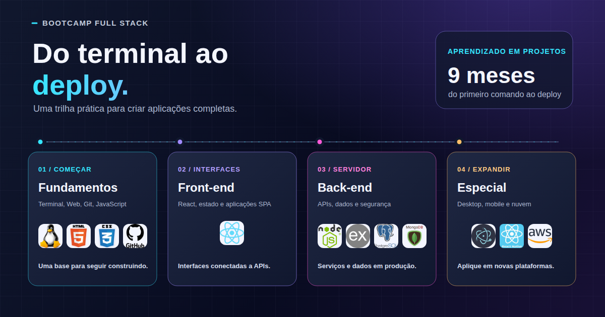

  

  <h1>Do terminal ao deploy. E daí, para o mundo.</h1>

  
<strong>Um caminho prático para sair dos fundamentos e construir aplicações completas.</strong>

  

    <a href="https://docs.google.com/forms/d/e/1FAIpQLSeC5qoa5echE7JwCRh4OlxejpJqkqQGQ7lIUBendcmzC4F0AQ/viewform"><strong>Quero saber mais e me inscrever</strong></a>
    &nbsp;·&nbsp;
    <a href="https://wa.me/5581998909050?text=Ol%C3%A1%21%20Vi%20o%20roadmap%20do%20Bootcamp%20Full%20Stack%20e%20tenho%20uma%20d%C3%BAvida.">Tirar uma dúvida pelo WhatsApp</a>
  

## Aprenda construindo

Estuda ADS e quer transformar os conceitos da faculdade em aplicações que funcionam de verdade? Neste bootcamp, você percorre a jornada completa do desenvolvimento web: começa pelo terminal e pelos fundamentos, passa por interfaces e APIs e chega a projetos integrados.

São **9 meses de aprendizado prático**, com projetos em cada etapa e acompanhamento próximo. A meta não é colecionar nomes de tecnologias: é entender como as peças se conectam e ganhar confiança para criar suas próprias soluções.

## Sua trilha

| Etapa                | O que você vai explorar                                                                                    |
| -------------------- | ---------------------------------------------------------------------------------------------------------- |
| **01 · Fundamentos** | Terminal, Web, Git, HTML, CSS e JavaScript. A base para entender o que acontece por trás de uma aplicação. |
| **02 · Front-end**   | React, componentes, estado, formulários, navegação e aplicações SPA integradas a APIs.                     |
| **03 · Back-end**    | Node.js, Express, APIs REST, arquitetura, SQL, bancos de dados, autenticação e Supabase.                   |
| **04 · Especial**    | Electron, React Native com Expo e AWS para levar aplicações ao desktop, ao celular e à nuvem.              |

Cada etapa inclui prática orientada. Ao longo do caminho, você trabalha em projetos individuais e em grupo, até conectar interface, API e dados numa aplicação completa.

## Vamos conversar?

Quer entender se o bootcamp combina com o seu momento? Conte um pouco sobre você no formulário ou mande sua dúvida pelo WhatsApp. Sem mistério: a ideia é explicar como funciona e ajudar você a decidir com tranquilidade.

  

    <a href="https://docs.google.com/forms/d/e/1FAIpQLSeC5qoa5echE7JwCRh4OlxejpJqkqQGQ7lIUBendcmzC4F0AQ/viewform"><strong>📋 Tenho interesse no bootcamp</strong></a>
    &nbsp;&nbsp;
    <a href="https://wa.me/5581998909050?text=Ol%C3%A1%21%20Vi%20o%20roadmap%20do%20Bootcamp%20Full%20Stack%20e%20tenho%20uma%20d%C3%BAvida."><strong>💬 Conversar pelo WhatsApp</strong></a>
  

